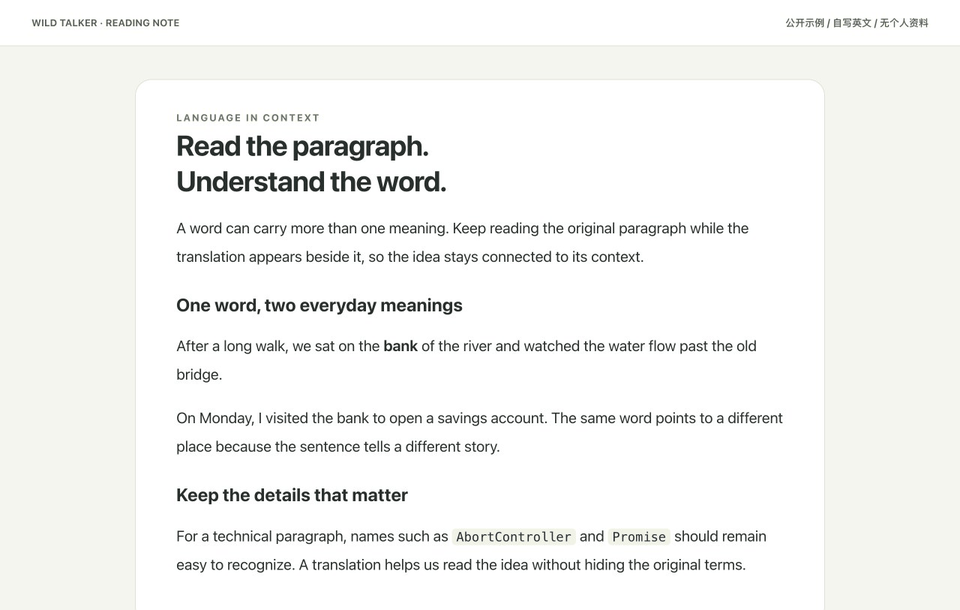
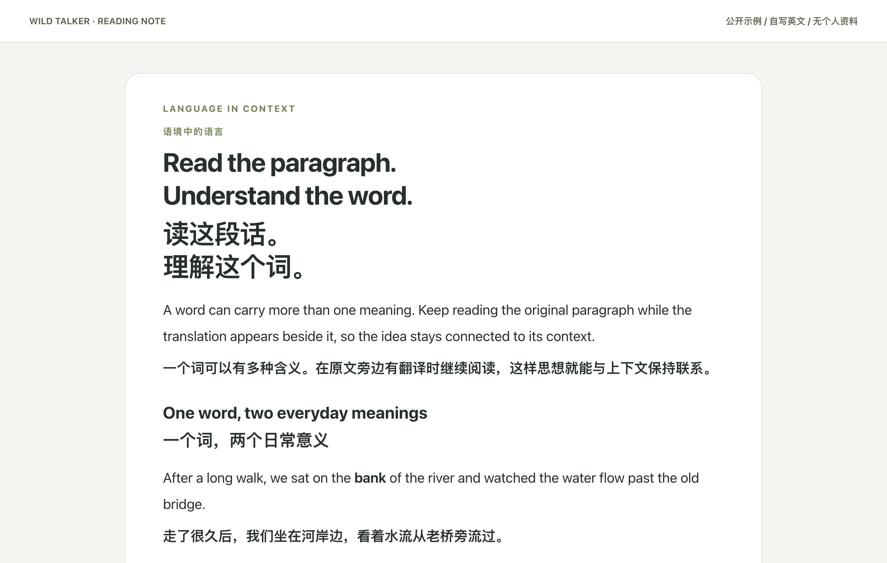
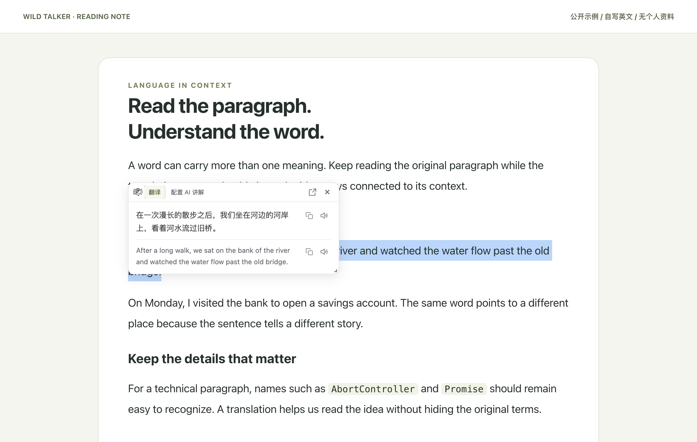
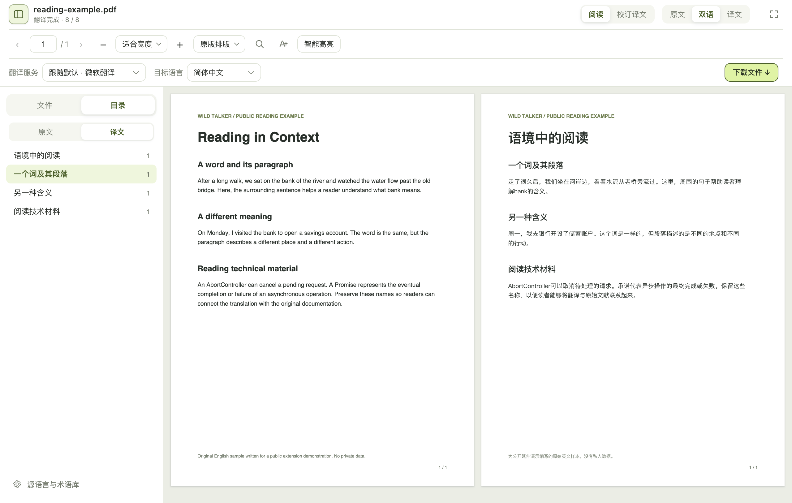
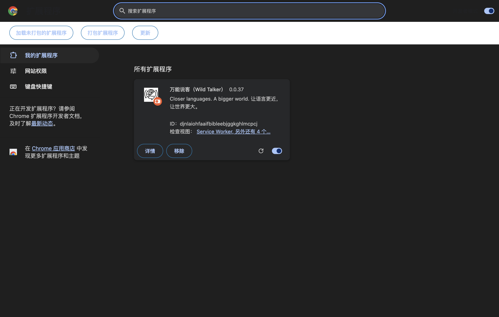
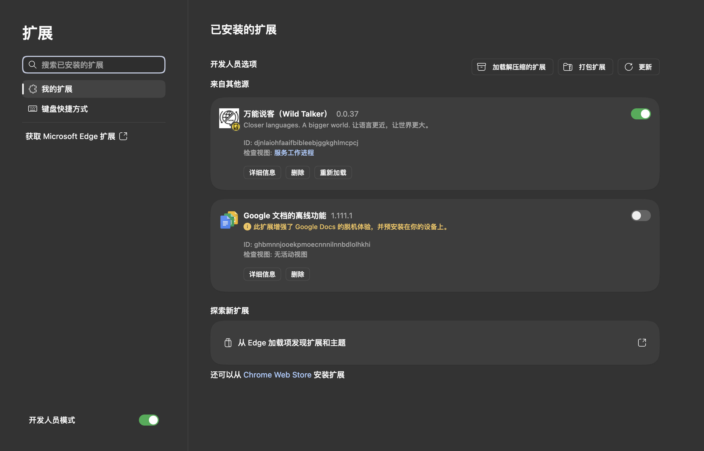

# 万能说客 Wild Talker · 浏览器双语翻译与 AI 阅读扩展

在 Chrome / Edge 中对照阅读外文网页与文档，用所在段落辅助划词翻译，并连接自己的 AI 服务。



*截图与动图录于 `0.0.37` 发布包，界面布局沿用至 `0.0.38`；新版修正新安装的默认主题。翻译服务、模型与原验证范围见[0.0.37 实测说明](./docs/guide/first-use-verification.md)，新版主题说明见[默认亮色修复](./docs/guide/theme-default-fix.md)。*

## [⬇ 下载 Chrome / Edge 安装包](https://github.com/YEMIN11238/wild-talker/releases/download/v0.0.38-wild-talker.1/wild-talker-0.0.38-chrome-edge.zip)

[发布说明与校验文件](https://github.com/YEMIN11238/wild-talker/releases/latest) · [产品演示与安装教程](https://yemin11238.github.io/wild-talker/) · [问题反馈](https://github.com/YEMIN11238/wild-talker/issues)

基于 [FluentRead](https://github.com/FluentRead/FluentRead)，本仓重点改进三件事：

- **划词带上段落语境**：参考上下文理解词义，选中的文字仍是翻译对象。
- **按阅读目的选择提示词**：自然阅读、技术文档、忠实直译三种预设，主动选择后生效。
- **文档失败时保留进度、尝试恢复**：特定格式校验失败可降低请求粒度，持续失败会停下并保留已完成译文。

## 三个阅读场景

### 网页双语翻译



保留原网页，在原文附近显示译文。网页翻译能力继承自 FluentRead；Wild Talker 整理了入口、弹窗和主题。

### 上下文划词翻译



选中词语或一句话，打开译文卡片；需要解释时可继续使用 AI 阅读辅助。上下文与提示词是否生效取决于服务和开关，见下文。

### 文档阅读



在插件内打开文档，对照原文、译文并查看进度。文件解析、PDF 排版和导出基础来自上游；本仓统一了文档 UI，并增加有界的校验失败恢复。

## 为什么使用 Wild Talker

**划词时，段落能帮助区分同一个词的不同含义。** 例如段落讲到河流时，选中 `bank` 的请求可以携带所在段落作为参考，翻译对象仍只有 `bank`，不会把整段改成翻译对象。需开启划词翻译与 **AI 精翻**，并使用支持通用提示词的 AI 服务；网页段落参考最多 500 字符。实际请求和结果见[实测案例](./docs/guide/first-use-verification.md#上下文划词)。此开关也启用继承的页面上下文能力，可能发送摘要及可读页面内容；500 字符只约束新增段落参考。模型可能不完全遵守输出约束，不代表一定比上游或其他模型更准确。

**读文章、读接口文档和核对原文，可以选择不同的翻译要求。** 在服务的提示词设置中主动选择：

| 预设 | 阅读目的 | 交给模型的要求 |
| --- | --- | --- |
| 自然阅读 | 阅读一般文章 | 保持意思、语气与不确定程度，允许调整句式，使译文自然。 |
| 技术文档 | 阅读 API、教程、论文 | 保留标识符、代码、单位、条件和警告，保持术语一致。 |
| 忠实直译 | 对照学习、核对论证 | 尽量贴近措辞和逻辑，保留歧义、重复、否定与保留意见。 |

例如翻译带 `--dry-run` 与 `may` 的技术句子，要求模型保留参数及“可能”的语气；具体输出与使用条件见[预设实测](./docs/guide/first-use-verification.md#提示词预设)。预设修改的是翻译要求，效果取决于所选模型，不保证输出一定不同。

**长文档不应因一段格式问题丢失此前进度。** 曾遇到 MiMo 报告中一个 624 字符段落的术语保护标记被服务丢弃，整个任务暂停。本仓在此类校验失败时尝试从合批请求降为单段，再对符合条件的纯文本段落拆句恢复；结果仍需通过原有校验，无法恢复时保留进度并显示错误。这一案例通过故障回放验证恢复路径，未声称完整报告在所有云服务上都能翻译成功。[案例与限制](./docs/guide/first-use-verification.md#文档恢复) · [开发层机制](./docs/maintainers/wild-talker-development.md)

## 第一次使用：下载安装 → 加载扩展 → 选择服务 → 完成第一次翻译

### 1. 下载安装

下载上方 Chrome / Edge ZIP，**解压到一个固定目录**。当前包的结构如下，应选择 `chrome-mv3` 这一层：

```text
解压目录/
└── chrome-mv3/     ← 加载这一层
    ├── manifest.json
    └── …
```

不要选择 ZIP 文件或外层解压目录。以后包结构若有变化，仍以**目录直接包含 manifest.json**为准。

| GitHub 发布标签 | 扩展管理页版本 | 安装包 |
| --- | --- | --- |
| `v0.0.38-wild-talker.1` | `0.0.38` | `wild-talker-0.0.38-chrome-edge.zip` |

标签中的 `wild-talker.1` 区分本仓改进版。一起核对名称 **万能说客（Wild Talker）**、本仓图标、下载来源和完整发布标签，确认安装的是本分支。**0.0.38 修复新安装默认主题为亮色**：没有保存主题的新安装不再跟随系统深色。已有 `dark` / `auto` 设置保持不变；旧安装仍显示深色时，到 **设置 → 通用设置 → 界面主题 → 亮色主题** 选择一次。[修复与升级说明](./docs/guide/theme-default-fix.md)

### 2. 加载扩展

Chrome 打开 `chrome://extensions`，Edge 打开 `edge://extensions`，开启 **开发者模式**，点击 **加载已解压的扩展程序**，选择**包含 manifest.json 的目录**。

| Chrome | Edge |
| --- | --- |
|  |  |

上面安装截图取自 `0.0.37`，加载步骤相同；当前下载的扩展卡片应显示 **0.0.38**。固定工具栏图标，刷新已经打开的网页。浏览器内部页、扩展商店等受限页面不能执行网页翻译。

### 3. 选择服务

打开插件，设定目标语言，再选择翻译服务。普通网页与文档翻译可以使用无需自备 AI API Key 的网页翻译服务；可用性取决于接口、地区与网络。AI 精翻、上下文解释及自定义提示词需要可用的 AI 服务，或自己运行的本地模型。

[无需 AI 与需要 AI 的能力划分](./docs/guide/first-use-verification.md#服务与启用条件) · [经过实测的自定义 API 示例](./docs/guide/first-use-verification.md#自定义-api-示例)

### 4. 完成第一次翻译

打开一篇可公开阅读的英文网页，点击 **翻译当前网页**，确认原文附近出现译文。需要划词时，在设置中启用划词翻译，选中文字并触发译文卡片；使用上下文功能还需完成 AI 服务配置并开启 AI 精翻。

遇到错误时先查看当前服务、模型和连接检查结果，再检查是否是受限页面。连接检查失败时，先解决报错再重试。[逐步教程](https://yemin11238.github.io/wild-talker/guide/getting-started)

## 升级

先按需导出备份，将新版 ZIP 解压后的内容放到**原来的扩展目录**，在扩展管理页点击 **重新加载**，核对版本 **0.0.38**，再刷新网页。已保存的暗色或跟随系统设置不会被升级强制覆盖；希望一直亮色时，到 **通用设置 → 界面主题 → 亮色主题** 选择一次。**跟随操作系统**仍可主动选择。保持扩展目录与 ID，避免先卸载导致本地设置和学习记录丢失。不要把个人备份或 API Key 放进源码仓库。

## 来源、维护与参与

网页、划词、文档、OCR、视频字幕及学习工具等基础主要继承自 FluentRead。本仓保留上游贡献历史、[GPL-3.0](./LICENSE) 和[第三方声明](./public/third-party-notices/)，增量范围见 [ATTRIBUTION.md](./ATTRIBUTION.md)。旧功能参考文档和历史测试材料不代表本仓独立原创或当前版本的实测结论。

已确定维护界面与入口一致性、划词段落参考、三种提示词预设，以及文档校验失败恢复。上游更新先在独立分支审阅，与本仓改动合并后验证；通过检查才发布新版本，不自动改变已有发布标签。[维护与上游同步流程](./docs/maintainers/wild-talker-development.md#维护与上游同步)

[开发与构建](./docs/maintainers/wild-talker-development.md) · [架构](./docs/architecture.md) · [完整测试说明](./docs/testing.md) · [数据处理](./docs/guide/privacy.md)

反馈请附浏览器版本、操作步骤、服务类型、错误提示与可公开示例，遮挡密钥和私人内容。本次素材使用干净测试配置和可公开文本；它们不构成翻译质量排名，也不能保证所有网页、模型或 PDF 都能成功处理。
